# System Architecture & Class Diagram — PS-128 (Team T025)

## Elderly Care Home Resident Care-Level Billing and Staffing Ratio Engine

---

## 1. Architectural Overview

The **Elderly Care Home Billing and Staffing Ratio Engine** is architected as a modular, event-driven, domain-centric system in Python. It is partitioned into five specialized engine modules coordinated by an orchestrator:

1. **`src/data_loader.py`**: Ingests, cross-validates, and enforces domain integrity across all 10 raw CSV data packs and command stream.
2. **`src/care_levels.py`**: Evaluates ADL/cognitive assessment scores, determines care-level bands (LEVEL_1–LEVEL_4), handles escalation rules (falls, conflict resolution), and tracks reassessment cadences.
3. **`src/billing.py`**: Computes calendar-day pro-rated monthly invoices, tiered continuous hospitalisation retention fees, add-on allowances, consumable handling caps, deposit adjustments, short-notice penalties, and late payment interest.
4. **`src/staffing.py`**: Computes caregiver and nurse ratios per wing and shift, enforces memory-wing dementia training constraints, handles 14-day medication error tightening, applies 48-hour weekly limits, and constructs 15-day shift rosters.
5. **`src/compliance.py`**: Audits the entire operational history for regulatory non-compliance, detecting overdue reassessments, staffing ratio shortfalls, and late fee payments.
6. **`src/main.py`**: Dispatches simulation events and orchestrates end-to-end execution, producing formatted CLI outputs and evaluation CSV files.

---

## 2. Complete Mermaid Class Diagram

```mermaid
classDiagram
    direction TB

    %% =========================================================================
    %% MODULE 1: DATA LOADER & VALIDATION
    %% =========================================================================
    class ValidationIssue {
        +str severity
        +str file_name
        +Optional~int~ row_index
        +Optional~str~ column
        +str message
    }

    class ValidationReport {
        +Dict file_summaries
        +List~ValidationIssue~ errors
        +List~ValidationIssue~ warnings
        +is_valid() bool
        +add_error(file_name, message, row_index, column)
        +add_warning(file_name, message, row_index, column)
        +print_summary()
    }

    class DataLoader {
        +Path data_dir
        +ValidationReport report
        +DataFrame wings
        +DataFrame fee_schedule
        +DataFrame addon_rates
        +DataFrame staffing_ratios
        +DataFrame residents
        +DataFrame assessments
        +DataFrame staff
        +DataFrame staff_leave
        +List commands
        +load_all() ValidationReport
        -_load_csv(filename, required_cols) DataFrame
        -_load_commands() List
        -_validate_date_string(date_str, format_str) bool
        -_validate_domain_constraints()
    }

    ValidationReport *-- ValidationIssue : aggregates
    DataLoader --> ValidationReport : produces & holds

    %% =========================================================================
    %% MODULE 2: CARE LEVELS
    %% =========================================================================
    class CareLevel {
        <<enumeration>>
        LEVEL_1
        LEVEL_2
        LEVEL_3
        LEVEL_4
        +rank() int
        +elevate(by: int) CareLevel
    }

    class Basis {
        <<enumeration>>
        ASSESSMENT
        FALL_RISK
        FALL_ESCALATION
    }

    class CareLevelRecord {
        +str resident_id
        +str effective_date
        +str care_level
        +str basis
        +Optional~str~ fall_risk_until
        +Optional~str~ assessment_id
        +to_dict() Dict
    }

    class ReassessmentStatus {
        +str resident_id
        +CareLevel current_level
        +str last_assessment_date
        +int cadence_days
        +str due_date
        +bool is_overdue
        +int days_overdue
    }

    class CareLevelManager {
        +Dict history
        +Dict assessments_by_resident
        +Dict falls_by_resident
        +Dict pending_decreases
        +get_cadence_days(care_level) int
        +process_all_data(assessments_df, commands)
        +record_fall(resident_id, fall_date) Optional~CareLevelRecord~
        +process_assessment(asm) CareLevelRecord
        +get_effective_care_level(resident_id, as_of_date) Optional~CareLevelRecord~
        +get_reassessment_status(resident_id, as_of_date) Optional~ReassessmentStatus~
        +get_overdue_assessments(as_of_date) List~ReassessmentStatus~
        +to_dataframe() DataFrame
        +print_care_plan(resident_id, resident_info) str
    }

    CareLevelManager o-- CareLevelRecord : manages history of
    CareLevelManager ..> CareLevel : uses
    CareLevelManager ..> Basis : uses
    CareLevelManager ..> ReassessmentStatus : generates

    %% =========================================================================
    %% MODULE 3: BILLING ENGINE
    %% =========================================================================
    class BillLine {
        +str bill_id
        +str resident_id
        +str month
        +str line_type
        +str description
        +int days
        +float rate
        +float amount
        +to_dict() Dict
    }

    class Invoice {
        +str bill_id
        +str resident_id
        +str resident_name
        +str wing_id
        +str room_type
        +str month
        +str issue_date
        +str due_date
        +str payment_mode
        +List~BillLine~ lines
        +float total_amount
        +float paid_amount
        +Optional~str~ payment_date
        +bool is_paid
        +bool is_late
        +finalize()
    }

    class HospitalEpisode {
        +str resident_id
        +str admit_date
        +Optional~str~ return_date
        +str hospital_name
        +bool bed_retained_full
    }

    class BillingEngine {
        +DataLoader loader
        +CareLevelManager cl_manager
        +Dict fee_schedule
        +Dict addon_rates
        +Dict hospital_episodes
        +Dict addons_by_month
        +Dict consumables_by_month
        +Dict payments
        +Dict discharge_notices
        +Dict vacate_events
        +Dict death_events
        +Dict invoices
        +Dict cumulative_hospital_days
        +Dict pending_interest
        +Dict residents
        +get_monthly_fee(care_level, room_type) float
        +is_in_hospital(resident_id, check_date) bool
        +process_command(verb, args, line_no)
        +generate_monthly_bills(month, issue_date)
        +print_invoice(resident_id, month) str
        +to_dataframe() DataFrame
        -_record_payment(resident_id, payment_date, mode)
        -_calculate_daily_fees(resident_id, month, days_in_month) List~BillLine~
        -_calculate_addons(resident_id, month) List~BillLine~
        -_calculate_consumables(resident_id, month) List~BillLine~
        -_calculate_adjustments(resident_id, month, days_in_month) List~BillLine~
        -_calculate_deposit_adjustment(resident_id, month) List~BillLine~
        -_calculate_interest(resident_id) List~BillLine~
    }

    Invoice *-- BillLine : contains 1..*
    BillingEngine --> DataLoader : queries static pricing
    BillingEngine --> CareLevelManager : queries effective levels
    BillingEngine o-- Invoice : generates & tracks
    BillingEngine o-- HospitalEpisode : tracks stay duration

    %% =========================================================================
    %% MODULE 4: STAFFING & ROSTERING ENGINE
    %% =========================================================================
    class StaffProfile {
        +str staff_id
        +str staff_name
        +str gender
        +str role
        +bool dementia_trained
        +int contract_hours_week
        +str home_wing
    }

    class ShiftRequirement {
        +str date
        +str shift
        +str wing_id
        +int caregivers_required
        +int nurses_required
        +int caregivers_assigned
        +int nurses_assigned
        +int shortfall
        +float agency_cost
        +List~str~ assigned_staff_ids
        +finalize()
        +to_dict() Dict
    }

    class RosterAssignment {
        +str date
        +str shift
        +str wing_id
        +str staff_id
        +str role
        +int hours
        +int week_hours_after
        +to_dict() Dict
    }

    class StaffingEngine {
        +DataLoader loader
        +CareLevelManager cl_manager
        +Dict staff
        +List~str~ caregivers
        +List~str~ nurses
        +Dict wings
        +Dict leave_records
        +Dict med_error_windows
        +Dict weekly_hours
        +Optional~date~ current_week_start
        +Dict shift_requirements
        +List~RosterAssignment~ roster_assignments
        +is_on_leave(staff_id, shift_date) bool
        +is_nurse_ratio_tightened(wing_id, shift_date) bool
        +calculate_shift_requirements(shift_date, shift, wing_id) ShiftRequirement
        +build_roster(from_date_str, to_date_str)
        +print_roster(wing_id, date_str, shift) str
        +to_staffing_requirements_dataframe() DataFrame
        +to_rosters_dataframe() DataFrame
        -_schedule_shift(shift_date, shift, wing_id, req)
        -_allocate_caregivers_for_wing(wing_id, shift_date, shift, req, needed)
        -_allocate_nurses_for_wing(wing_id, shift_date, shift, req, needed)
    }

    StaffingEngine --> DataLoader : queries staff & leave
    StaffingEngine --> CareLevelManager : queries acuity for ratios
    StaffingEngine o-- StaffProfile : maintains profiles of
    StaffingEngine o-- ShiftRequirement : tracks per shift
    StaffingEngine o-- RosterAssignment : generates assignments

    %% =========================================================================
    %% MODULE 5: REGULATORY COMPLIANCE ENGINE
    %% =========================================================================
    class ComplianceFinding {
        +str month
        +str finding_type
        +str ref_id
        +str detail
        +to_dict() Dict
    }

    class ComplianceEngine {
        +CareLevelManager cl_manager
        +BillingEngine billing
        +StaffingEngine staffing
        +List~ComplianceFinding~ findings
        +check_overdue_reassessments(month) List~ComplianceFinding~
        +check_ratio_breaches(month) List~ComplianceFinding~
        +check_late_payments(month) List~ComplianceFinding~
        +compile_all_findings() List~ComplianceFinding~
        +get_findings_for_month(month) List~ComplianceFinding~
        +print_compliance(month) str
        +to_dataframe() DataFrame
        +export_csv(filepath) DataFrame
    }

    ComplianceEngine --> CareLevelManager : audits assessment cadence
    ComplianceEngine --> BillingEngine : audits payment timelines
    ComplianceEngine --> StaffingEngine : audits shift shortfalls
    ComplianceEngine o-- ComplianceFinding : records audit findings
```

---

## 3. Detailed Class Reference by Module

### Module 1: Data Ingestion & Validation (`src/data_loader.py`)

#### 1. `ValidationIssue`
- **Purpose**: Data transfer object representing a specific schema violation, missing value, referential integrity flaw, or format warning encountered during data loading.
- **Attributes**:
  - `severity`: String indicating issue level (`"ERROR"` or `"WARNING"`).
  - `file_name`: Name of the source CSV or text file.
  - `row_index`: 0-indexed or 1-indexed row number where the issue occurred (if applicable).
  - `column`: Target column name (if applicable).
  - `message`: Descriptive diagnostic explanation.

#### 2. `ValidationReport`
- **Purpose**: Accumulator for validation issues and summary metrics across all files.
- **Attributes**:
  - `file_summaries`: Dictionary mapping file names to record and column counts.
  - `errors`: List of fatal `ValidationIssue` objects.
  - `warnings`: List of non-fatal informational `ValidationIssue` objects (e.g. RES-050/RES-070 future admission dates).
- **Key Methods**:
  - `is_valid() -> bool`: Returns `True` if zero fatal errors exist.
  - `add_error(...)`: Records an error issue.
  - `add_warning(...)`: Records a warning issue.
  - `print_summary()`: Outputs human-readable terminal audit summary.

#### 3. `DataLoader`
- **Purpose**: Central repository and ingestion engine that loads, parses, and validates all 10 CSV datasets and the `commands.txt` simulation stream.
- **Attributes**:
  - `data_dir`: Root directory containing input CSVs.
  - `report`: Instance of `ValidationReport`.
  - `wings`, `fee_schedule`, `addon_rates`, `staffing_ratios`, `residents`, `assessments`, `staff`, `staff_leave`: Parsed `pandas.DataFrame` tables.
  - `commands`: Chronologically ordered list of parsed tuples `(verb, args, line_no, raw_line)`.
- **Key Methods**:
  - `load_all() -> ValidationReport`: Orchestrates loading and validation across all files.
  - `_load_csv(...) -> pd.DataFrame`: Reads CSV and checks required columns.
  - `_load_commands() -> List`: Parses piped commands and discards comments.
  - `_validate_date_string(...) -> bool`: Validates ISO date formats.
  - `_validate_domain_constraints()`: Enforces foreign key relationships, score ranges, and numerical bounds.

---

### Module 2: Care Level Management (`src/care_levels.py`)

#### 4. `CareLevel` (Enum)
- **Purpose**: Strongly-typed enumeration of elderly care dependency classifications.
- **Values**: `LEVEL_1` (Low Dependency), `LEVEL_2` (Medium Dependency), `LEVEL_3` (High Dependency), `LEVEL_4` (Maximum Dependency).
- **Key Methods**:
  - `rank() -> int`: Returns integer ordinal (1 to 4) for comparisons.
  - `elevate(by: int) -> CareLevel`: Safely increases care level by $N$, capped at `LEVEL_4`.
  - Operator overrides (`<`, `<=`, `>`, `>=`): Enables direct comparison between levels.

#### 5. `Basis` (Enum)
- **Purpose**: Enumerates the legal regulatory justification for care level classification in `care_levels.csv`.
- **Values**: `ASSESSMENT` (direct clinical scoring), `FALL_RISK` (single level elevation from fall-risk flag), `FALL_ESCALATION` (escalation triggered by 2 falls in $\le 30$ days).

#### 6. `CareLevelRecord`
- **Purpose**: Immutable history record representing a resident's care level at an effective date.
- **Attributes**: `resident_id`, `effective_date`, `care_level`, `basis`, `fall_risk_until`, `assessment_id`.
- **Key Methods**:
  - `to_dict() -> Dict`: Formats record for evaluation DataFrame serialization.

#### 7. `ReassessmentStatus`
- **Purpose**: Clinical monitoring object tracking reassessment timeliness and due dates.
- **Attributes**: `resident_id`, `current_level`, `last_assessment_date`, `cadence_days` (30 or 90), `due_date`, `is_overdue`, `days_overdue`.

#### 8. `CareLevelManager`
- **Purpose**: Core domain engine managing resident clinical assessments, score conversions, fall escalations, and timeline state transitions.
- **Attributes**:
  - `history`: Maps `resident_id` to chronological list of `CareLevelRecord`s.
  - `assessments_by_resident`: Stores raw historical assessment events.
  - `falls_by_resident`: Tracks timestamps of resident falls.
  - `pending_decreases`: Stores care level decreases scheduled to take effect on the 1st of the following month.
- **Key Methods**:
  - `get_cadence_days(care_level) -> int`: Returns 90 days for LEVEL_1/2, 30 days for LEVEL_3/4.
  - `process_all_data(...)`: Chronologically interleaves assessments and fall events.
  - `record_fall(resident_id, fall_date) -> Optional[CareLevelRecord]`: Implements Rule EC-07 (2 falls in $\le 30$ days triggers immediate escalation).
  - `process_assessment(asm) -> CareLevelRecord`: Evaluates ADL/cognitive bands, takes higher level on conflict (EC-01), applies fall-risk elevation (EC-02), and schedules immediate increase (EC-03) or next-month decrease (RES-050).
  - `get_effective_care_level(resident_id, as_of_date) -> Optional[CareLevelRecord]`: Retrieves the active care level for any calendar date.
  - `get_reassessment_status(...) -> Optional[ReassessmentStatus]`: Calculates overdue status against cadence.
  - `get_overdue_assessments(as_of_date) -> List[ReassessmentStatus]`: Lists all residents overdue for clinical reassessment.
  - `to_dataframe() -> pd.DataFrame`: Emits `care_levels.csv` schema.
  - `print_care_plan(resident_id, resident_info) -> str`: Formats human-readable care plan statement.

---

### Module 3: Billing & Invoicing Engine (`src/billing.py`)

#### 9. `BillLine`
- **Purpose**: Represents a single itemized billing entry on a resident's monthly invoice.
- **Attributes**: `bill_id`, `resident_id`, `month`, `line_type` (`FEE`, `HOSPITAL_RETENTION`, `ADDON`, `CONSUMABLE`, `HANDLING`, `NOTICE_CHARGE`, `REFUND`, `DEPOSIT_ADJUSTMENT`, `INTEREST`), `description`, `days`, `rate`, `amount`.
- **Key Methods**:
  - `to_dict() -> Dict`: Formats line item for `bills.csv`.

#### 10. `Invoice`
- **Purpose**: Container for a resident's complete monthly bill.
- **Attributes**: `bill_id` (`BILL-<resident_id>-<YYYY-MM>`), `resident_id`, `resident_name`, `wing_id`, `room_type`, `month`, `issue_date` (1st of next month), `due_date` (10th of issue month), `payment_mode`, `lines` (List of `BillLine`), `total_amount`, `paid_amount`, `payment_date`, `is_paid`, `is_late`.
- **Key Methods**:
  - `finalize()`: Sums line amounts and rounds to 2 decimal places.

#### 11. `HospitalEpisode`
- **Purpose**: Tracks continuous hospital stays across calendar months for tiered retention calculation.
- **Attributes**: `resident_id`, `admit_date`, `return_date`, `hospital_name`, `bed_retained_full` (boolean flag for family retention beyond 60 days).

#### 12. `BillingEngine`
- **Purpose**: Financial accounting and billing calculation engine.
- **Attributes**:
  - `loader`: Reference to `DataLoader`.
  - `cl_manager`: Reference to `CareLevelManager`.
  - `fee_schedule`, `addon_rates`: In-memory pricing lookup tables.
  - `hospital_episodes`: Historical list of hospital admissions per resident.
  - `addons_by_month`, `consumables_by_month`: Event logs grouped by billing month.
  - `invoices`: Maps `(resident_id, month)` to `Invoice` instances.
  - `cumulative_hospital_days`: Tracks cumulative hospital days across month boundaries.
  - `pending_interest`: Unbilled late interest charges carried forward.
- **Key Methods**:
  - `get_monthly_fee(care_level, room_type) -> float`: Looks up base fee.
  - `is_in_hospital(resident_id, check_date) -> bool`: Checks hospitalisation status on a specific date.
  - `process_command(verb, args, line_no)`: Ingests billing simulation events (`HOSPITAL_ADMIT/RETURN`, `BED_RETAIN`, `ADDON`, `CONSUMABLE`, `DISCHARGE_NOTICE`, `VACATE`, `DEATH`, `PAYMENT`, `GENERATE_BILLS`).
  - `generate_monthly_bills(month, issue_date)`: Builds itemized bills for all active residents.
  - `_calculate_daily_fees(...)`: Calendar-day pro-rated residential and hospital retention fees (50% for days 1–30, 25% for days 31–60, 100% with BED_RETAIN FULL).
  - `_calculate_addons(...)`: Applies 2 free doctor visits per month, excludes add-ons during hospital stay.
  - `_calculate_consumables(...)`: Computes consumables cost and 10% handling fee capped at Rs 2000.
  - `_calculate_adjustments(...)`: Handles 50% short notice fee (EC-08) and post-death refunds.
  - `_calculate_deposit_adjustment(...)`: Bills 2-month deposit difference upon care-level increase.
  - `_calculate_interest(...)`: Applies 1.5% interest on unpaid late bills.
  - `print_invoice(resident_id, month) -> str`: Formats human-readable invoice statement.
  - `to_dataframe() -> pd.DataFrame`: Emits `bills.csv` schema.

---

### Module 4: Staffing & Scheduling Engine (`src/staffing.py`)

#### 13. `StaffProfile`
- **Purpose**: Data transfer object representing a caregiver or nurse employee.
- **Attributes**: `staff_id`, `staff_name`, `gender`, `role` (`CAREGIVER` or `NURSE`), `dementia_trained` (bool), `contract_hours_week` (48), `home_wing`.

#### 14. `ShiftRequirement`
- **Purpose**: Staffing demand and shortfall accounting object for a single wing and shift.
- **Attributes**: `date`, `shift` (`DAY` or `NIGHT`), `wing_id`, `caregivers_required`, `nurses_required`, `caregivers_assigned`, `nurses_assigned`, `shortfall`, `agency_cost`, `assigned_staff_ids`.
- **Key Methods**:
  - `finalize()`: Computes total shortfall and agency replacement cost ($\text{shortfall} \times \text{Rs } 2500.00$).
  - `to_dict() -> Dict`: Emits row for `staffing_requirements.csv`.

#### 15. `RosterAssignment`
- **Purpose**: Individual shift assignment record for a staff member.
- **Attributes**: `date`, `shift`, `wing_id`, `staff_id`, `role`, `hours` (12), `week_hours_after` (cumulative weekly hours worked through this shift).
- **Key Methods**:
  - `to_dict() -> Dict`: Emits row for `rosters.csv`.

#### 16. `StaffingEngine`
- **Purpose**: Staff allocation, ratio enforcement, and 15-day roster scheduling engine.
- **Attributes**:
  - `loader`: Reference to `DataLoader`.
  - `cl_manager`: Reference to `CareLevelManager`.
  - `staff`: Map of `staff_id` to `StaffProfile`.
  - `caregivers`, `nurses`: Lists of staff IDs grouped by role.
  - `leave_records`: Approved staff leave windows from `staff_leave.csv`.
  - `med_error_windows`: Medication error tracking for 14-day ratio tightening.
  - `weekly_hours`: Rolling hours worked by staff in the current Monday–Sunday week.
  - `shift_requirements`: Map of `(date, shift, wing_id)` to `ShiftRequirement`.
  - `roster_assignments`: Chronological list of `RosterAssignment` records.
- **Key Methods**:
  - `is_on_leave(staff_id, shift_date) -> bool`: Checks if employee is on leave.
  - `is_nurse_ratio_tightened(wing_id, shift_date) -> bool`: Checks 14-day 1:15 ratio window after a medication error.
  - `calculate_shift_requirements(shift_date, shift, wing_id) -> ShiftRequirement`: Computes ratio requirements based on resident acuity, halving night caregiver demand for LEVEL_1 and LEVEL_2, and applying nurse minimums.
  - `build_roster(from_date, to_date)`: Builds complete 15-day schedule enforcing:
    1. Maximum 48 hours per week (Mon–Sun).
    2. Maximum 1 shift (12 hours) per staff member per calendar day.
    3. Mandatory dementia training for caregivers assigned to WING-M.
    4. Deterministic tie-breaking by lowest `staff_id`.
    5. Shortfall flagging and agency cost evaluation when available staff is exhausted.
  - `print_roster(wing_id, date, shift) -> str`: Formats human-readable shift roster statement.
  - `to_staffing_requirements_dataframe() -> pd.DataFrame`: Emits `staffing_requirements.csv`.
  - `to_rosters_dataframe() -> pd.DataFrame`: Emits `rosters.csv`.

---

### Module 5: Regulatory Compliance Engine (`src/compliance.py`)

#### 17. `ComplianceFinding`
- **Purpose**: Represents an identified regulatory violation, ratio breach, or operational audit finding.
- **Attributes**: `month`, `finding_type` (`OVERDUE_REASSESSMENT`, `RATIO_BREACH`, or `LATE_PAYMENT`), `ref_id`, `detail`.
- **Key Methods**:
  - `to_dict() -> Dict`: Emits row for `compliance.csv`.

#### 18. `ComplianceEngine`
- **Purpose**: Regulatory audit engine that cross-examines clinical, billing, and staffing operations.
- **Attributes**:
  - `cl_manager`: Reference to `CareLevelManager`.
  - `billing`: Reference to `BillingEngine`.
  - `staffing`: Reference to `StaffingEngine`.
  - `findings`: Aggregated list of `ComplianceFinding` objects.
- **Key Methods**:
  - `check_overdue_reassessments(month) -> List[ComplianceFinding]`: Detects periodic assessments delayed past 30-day (LEVEL_3/4) or 90-day (LEVEL_1/2) cadences.
  - `check_ratio_breaches(month) -> List[ComplianceFinding]`: Scans staffing shifts for shortfalls ($\text{shortfall} > 0$).
  - `check_late_payments(month) -> List[ComplianceFinding]`: Audits billing payments received after the 10th of the month.
  - `compile_all_findings() -> List[ComplianceFinding]`: Aggregates and sorts all findings deterministically by `(month, finding_type, ref_id)`.
  - `print_compliance(month) -> str`: Formats regulatory compliance report for `PRINT_COMPLIANCE|YYYY-MM`.
  - `to_dataframe() -> pd.DataFrame`: Emits `compliance.csv` schema.
  - `export_csv(filepath) -> pd.DataFrame`: Saves findings directly to CSV.

---

### Module 6: Command Orchestrator (`src/main.py`)

`src/main.py` is the procedural CLI pipeline driver (not a class). It contains:
- `parse_arguments()`: CLI flag parsing (`--data-dir`, `--output-dir`, `--commands-file`, `-v`, `-q`).
- `execute_pipeline(...)`: End-to-end execution pipeline connecting all 5 engine classes, streaming commands, and exporting all 5 output CSV files.
- `main()`: Script entrypoint.

---

## 4. Class Relationships & Interactions Explained in Simple English

1. **How Data Flows into the System**:
   - `DataLoader` reads raw CSV files into pandas DataFrames and validates them using `ValidationReport` and `ValidationIssue`.
   - Once validated, `DataLoader` supplies data to `CareLevelManager`, `BillingEngine`, and `StaffingEngine`.

2. **How Care Levels Drive Other Modules**:
   - `CareLevelManager` determines each resident's care level (using `CareLevel` and `Basis` enums) and records changes in `CareLevelRecord`.
   - `BillingEngine` asks `CareLevelManager` for each resident's care level on each day of the month to calculate accurate daily room and care charges.
   - `StaffingEngine` asks `CareLevelManager` for resident care levels in each wing to calculate the exact number of caregivers and nurses required for each shift.

3. **How Billing is Organized**:
   - `BillingEngine` produces `Invoice` objects for each resident each month.
   - Each `Invoice` is composed of individual `BillLine` objects (daily fees, add-on services, consumables, deposit adjustments, hospital retention, and interest).
   - If a resident is hospitalised, `BillingEngine` records a `HospitalEpisode` to track cumulative hospital days across months.

4. **How Staffing and Rostering Work**:
   - `StaffingEngine` maintains `StaffProfile` objects for all 40 employees.
   - For every shift, it creates a `ShiftRequirement` showing required staff, assigned staff, shortfalls, and agency replacement costs.
   - For every assigned shift, it creates a `RosterAssignment` recording the employee's ID, shift hours (12), and rolling weekly hours.

5. **How Compliance Auditing Works**:
   - `ComplianceEngine` acts as an independent auditor with references to `CareLevelManager`, `BillingEngine`, and `StaffingEngine`.
   - It checks `CareLevelManager` for late clinical reassessments (`OVERDUE_REASSESSMENT`).
   - It checks `StaffingEngine` for shifts with staff shortages (`RATIO_BREACH`).
   - It checks `BillingEngine` for invoices paid after the 10th of the month (`LATE_PAYMENT`).
   - All findings are converted into `ComplianceFinding` objects and exported to `compliance.csv`.

---

## 5. Design Patterns Applied

| Pattern | Where Applied | Purpose |
|---|---|---|
| **Facade Pattern** | `DataLoader`, `BillingEngine`, `StaffingEngine` | Provides simple public interfaces (`load_all`, `generate_monthly_bills`, `build_roster`) that hide internal multi-step business logic. |
| **Data Transfer Object (DTO)** | `ValidationIssue`, `BillLine`, `ShiftRequirement`, `RosterAssignment`, `ComplianceFinding` | Lightweight dataclasses encapsulating structured data records and exporting cleanly to dictionaries and CSV rows. |
| **Strategy / Enumeration Pattern** | `CareLevel`, `Basis` | Encapsulates domain classifications with comparison rankings (`rank()`) and safe mutation (`elevate()`). |
| **Event-Driven Dispatcher** | `BillingEngine.process_command()`, `main.execute_pipeline()` | Processes chronological simulation commands from `commands.txt` in file order, updating engine states. |
| **Independent Auditor Pattern** | `ComplianceEngine` | Decouples compliance verification from core business calculation, auditing domain engines via clean public APIs. |
