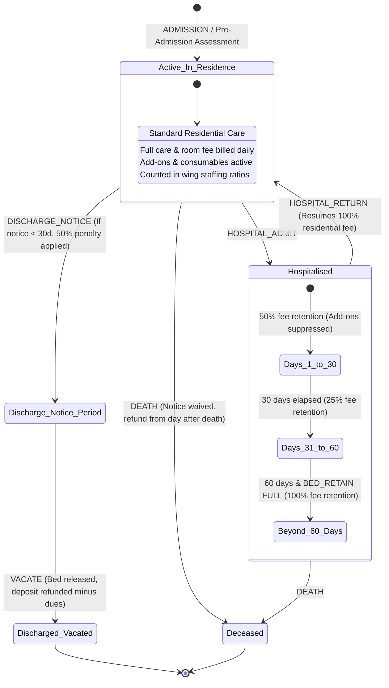
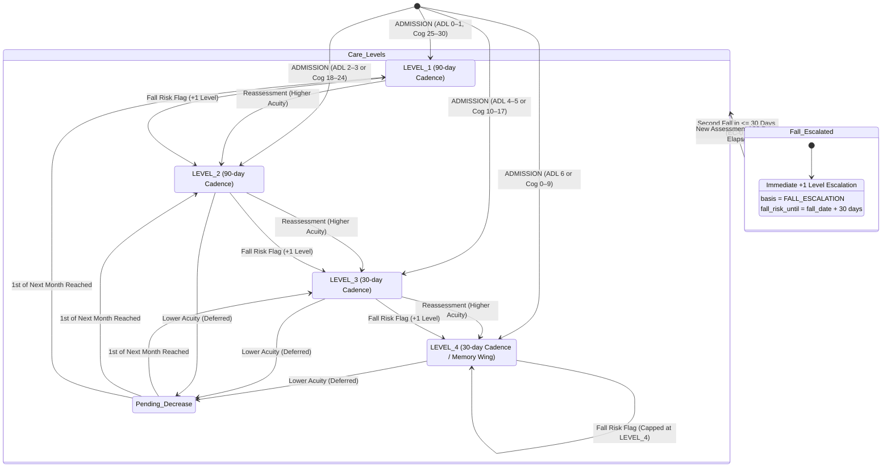

# System Design Document — PS-128 (Team T025)

## Elderly Care Home Resident Care-Level Billing and Staffing Ratio Engine

---

## 1. Project Introduction

The **Elderly Care Home Resident Care-Level Billing and Staffing Ratio Engine** is an event-driven, domain-centric management and regulatory compliance system designed for assisted living and residential elderly care homes.

- **Project ID:** PS-128
- **Team ID:** T025
- **Programming Language:** Python 3.10+ (Developed and verified on Python 3.14)
- **Target Deadline:** 26 November 2026
- **Architecture Pattern:** Layered Modular Architecture with Event-Driven Command Dispatching

The system ingests resident demographic, clinical assessment, staffing, and facility data, processes an operational stream of clinical and administrative events over a simulation quarter (August – October 2026), and outputs deterministic financial, staffing, and regulatory audit files conforming to strict regulatory evaluation schemas.

---

## 2. Problem Statement

Modern elderly care facilities face severe operational challenges arising from the interplay between clinical care dependency, financial accounting, and statutory staffing obligations:

1. **Dynamic Resident Acuity**: Residents' physical and cognitive abilities fluctuate over time. Falls, acute illnesses, and clinical deterioration require rapid changes in care dependency classifications, while improvements must be verified before lowering fees.
2. **Complex Financial Accounting**: Billing cannot be flat-rate. Care fees vary by room type and care level; hospitalisations require continuous tiered discounts spanning multiple billing cycles; add-ons carry service-specific free allowances; consumables incur capped handling fees; and move-ins, discharges, or deaths demand precise calendar-day pro-rating.
3. **Strict Staffing Compliance**: Regulatory standards mandate strict caregiver-to-resident ratios tailored to acuity, nurse minimums per wing per shift, specialized dementia-training requirements for memory care wings, and a statutory 48-hour maximum work week per staff member. Unforeseen staff shortages require agency staffing at fixed penalty costs.
4. **Audit and Regulatory Scrutiny**: Care homes must provide transparent proof that reassessments were conducted within statutory cadences (30 or 90 days), that shift staffing ratios were never breached without recorded shortfalls, and that billing late payments were tracked accurately.

Manual spreadsheet tracking or fragmented systems lead to billing leakage, nurse burnout, legal penalties, and compliance failures. This project delivers an automated, transparent, and provably compliant software engine that solves these problems.

---

## 3. Project Objectives

The core objectives of the PS-128 system are:

1. **Robust Data Ingestion & Schema Validation**: Ingest 10 distinct CSV datasets and command files, validating primary keys, foreign key relationships, score boundaries, and date formats without altering raw inputs.
2. **Deterministic Care-Level Determination**: Implement clinical classification rules mapping ADL (0–6) and cognitive scores (0–30) to `LEVEL_1` through `LEVEL_4`, resolving score conflicts in favor of higher resident safety, elevating levels for fall risk, and triggering immediate escalation for recurring falls within 30 days.
3. **Fair and Transparent Billing**: Generate monthly bills in arrears with daily calendar pro-rating, continuous hospitalisation tracking across month boundaries (50% for days 1–30, 25% for days 31–60, 100% under `BED_RETAIN FULL`), add-on allowance deductions, consumable handling caps (Rs 2,000), short-notice departure fees, death waivers, and late interest charges.
4. **Constrained Staff Rostering**: Calculate exact caregiver and nurse requirements per wing and shift, enforce 48-hour weekly contract limits and 1-shift-per-day limits, mandate dementia certification in memory wings, and assign agency staff with shortfall costs when facility capacity is exhausted.
5. **Continuous Regulatory Compliance Auditing**: Cross-examine clinical cadences, shift coverage, and billing receipts to record all overdue assessments, ratio breaches, and late payments in a standardized compliance register.
6. **Command Stream Execution**: Sequentially execute all 17 simulation command verbs from `commands.txt` and generate all 5 mandatory evaluation CSV files matching the required output format.

---

## 4. System Architecture

The application adopts a **Layered Modular Architecture** with clean separation of concerns:

```text
┌────────────────────────────────────────────────────────────────────────┐
│                   CLI Orchestration Layer (src/main.py)                │
│       - Argument Parsing (--data-dir, --output-dir, -v, -q)            │
│       - Chronological Command Stream Ingestion (commands.txt)          │
│       - Formatted Text Displays (Roster, Bill, Compliance, Care Plan)  │
└───────┬───────────────────┬───────────────────┬─────────────────┬──────┘
        │                   │                   │                 │
┌───────▼───────────┐ ┌─────▼───────────┐ ┌─────▼───────────┐ ┌───▼──────────┐
│   Care Levels     │ │ Billing Engine  │ │ Staffing Engine │ │  Compliance  │
│  (care_levels.py) │ │  (billing.py)   │ │  (staffing.py)  │ │(compliance.py│
│ - ADL/Cog Mapping │ │ - Daily Pro-rata│ │ - Day/Night Rato│ │ - Overdue Asm│
│ - Fall Risk (+1)  │ │ - Hospital Tiers│ │ - 48h Weekly Cap│ │ - Ratio Short│
│ - Fall Escalation │ │ - Add-on Limits │ │ - 1 Shift / Day │ │ - Late Pays  │
│ - Next-Month Drop │ │ - Consumable Cap│ │ - Dementia Cert │ │ - CSV Export │
│ - 30d/90d Cadence │ │ - Deposit Diffs │ │ - Shortfall Rs  │ │              │
└───────┬───────────┘ └─────┬───────────┘ └─────┬───────────┘ └───▲──────────┘
        │                   │                   │                 │
        │                   └─────────┬─────────┴─────────────────┘
        │                             │ Queries Acuity & Invoices
┌───────▼─────────────────────────────▼──────────────────────────────────┐
│                      Data Ingestion & Integrity Layer                  │
│                            (src/data_loader.py)                        │
│ - DataLoader: CSV Parsing, PK/FK Referentials, Score Bounds            │
│ - ValidationReport: Diagnostic Error/Warning Aggregator                │
└─────────────────────────────────────┬──────────────────────────────────┘
                                      │ Ingests Raw Data Packs
┌─────────────────────────────────────▼──────────────────────────────────┐
│                          Data Storage / CSV Files                      │
│ wings.csv | fee_schedule.csv | addon_rates.csv | staffing_ratios.csv   │
│ residents.csv | assessments.csv | staff.csv | staff_leave.csv          │
└────────────────────────────────────────────────────────────────────────┘
```

### Architectural Principles Applied:
- **Single Responsibility Principle (SRP)**: Each module owns exactly one operational domain (ingestion, clinical scoring, billing, staffing, compliance).
- **Immutability of Source Data**: Raw input CSVs and command logs are never edited or overwritten.
- **Deterministic Pipeline Execution**: State transitions are evaluated sequentially in chronological order, eliminating race conditions or timing dependencies.
- **Fail-Safe Validation**: Data errors are captured in a structured `ValidationReport` before execution proceeds.

---

## 5. Project Modules and Their Functions

### 5.1 `src/data_loader.py` (Data Loading & Validation Engine)
- **Primary Classes**: `DataLoader`, `ValidationReport`, `ValidationIssue`.
- **Functions**:
  - `load_all()`: Ingests all CSV files and `commands.txt`.
  - `_load_csv()`: Enforces required column headers and schema conformance.
  - `_load_commands()`: Tokenizes piped command strings, ignoring comments and blank lines.
  - `_validate_domain_constraints()`: Enforces foreign key relationships (residents to wings, staff to wings, assessments to residents), numerical bounds (ADL 0–6, Cognitive 0–30), and records warnings for clerical anomalies (e.g. RES-050/RES-070 future admission dates).

### 5.2 `src/care_levels.py` (Care-Level Management Module)
- **Primary Classes**: `CareLevelManager`, `CareLevelRecord`, `ReassessmentStatus`, `CareLevel` (Enum), `Basis` (Enum).
- **Functions**:
  - `process_assessment()`: Scores ADL and cognitive bands, resolves conflicts by taking the higher level (EC-01), applies fall-risk elevation capped at LEVEL_4 (EC-02), executes immediate increases (EC-03), and defers decreases to the 1st of the following month (RES-050).
  - `record_fall()`: Evaluates fall history and triggers immediate +1 level escalation with `basis = FALL_ESCALATION` if a second fall occurs within $\le 30$ days (EC-07).
  - `get_effective_care_level()`: Returns the active care level for any resident on any calendar date.
  - `get_reassessment_status()`: Computes days until due or days overdue against statutory cadences (90 days for LEVEL_1/2; 30 days for LEVEL_3/4).
  - `print_care_plan()`: Generates human-readable resident care plan statements.
  - `to_dataframe()`: Exports `outputs/care_levels.csv`.

### 5.3 `src/billing.py` (Monthly Billing & Invoicing Engine)
- **Primary Classes**: `BillingEngine`, `Invoice`, `BillLine`, `HospitalEpisode`.
- **Functions**:
  - `process_command()`: Handles administrative billing commands (`HOSPITAL_ADMIT`, `HOSPITAL_RETURN`, `BED_RETAIN`, `ADDON`, `CONSUMABLE`, `DISCHARGE_NOTICE`, `VACATE`, `DEATH`, `PAYMENT`, `GENERATE_BILLS`).
  - `generate_monthly_bills()`: Calculates calendar-day daily pro-rata charges for each active resident.
  - `_calculate_daily_fees()`: Applies room and care level fees, integrating hospital retention tiers (Days 1–30 @ 50%, Days 31–60 @ 25%, >60 Days @ 100% under `BED_RETAIN FULL`).
  - `_calculate_addons()`: Applies free allowances (2 free doctor visits per month, excess @ Rs 1,500) and suppresses add-ons during hospitalisation (EC-04).
  - `_calculate_consumables()`: Sums item actual costs and applies 10% handling capped at Rs 2,000/month.
  - `_calculate_adjustments()`: Applies 50% monthly fee penalties for short notice discharges $< 30$ days (EC-08) and pro-rata refunds post-death (RES-023).
  - `_calculate_deposit_adjustment()`: Charges 2-month deposit difference upon care-level increase.
  - `_calculate_interest()`: Assesses 1.5% interest on unpaid late invoices.
  - `print_invoice()`: Formats human-readable monthly billing invoices.
  - `to_dataframe()`: Exports `outputs/bills.csv`.

### 5.4 `src/staffing.py` (Staffing Ratios & 15-Day Rostering Engine)
- **Primary Classes**: `StaffingEngine`, `StaffProfile`, `ShiftRequirement`, `RosterAssignment`.
- **Functions**:
  - `calculate_shift_requirements()`: Determines caregiver demand from resident acuity (halving night demand for LEVEL_1/2) and enforces nurse minimums (1 per wing per shift, 1:20 day, 1:40 night).
  - `is_nurse_ratio_tightened()`: Detects active 14-day 1:15 nurse ratio tightening windows following a medication error (EC-05).
  - `build_roster()`: Schedules staff over the 15-day roster window (Oct 5–19, 2026) enforcing:
    1. Maximum 48 hours worked per week (Monday to Sunday).
    2. Maximum 1 shift (12 hours) per staff member per calendar day.
    3. Mandatory dementia training for caregivers assigned to WING-M.
    4. Deterministic tie-breaking by lowest staff ID.
    5. Shortfall assignment and agency cost calculation ($\text{shortfall} \times \text{Rs } 2500$) when staff hours are exhausted (EC-06).
  - `print_roster()`: Formats human-readable shift roster statements.
  - `to_staffing_requirements_dataframe()`: Exports `outputs/staffing_requirements.csv`.
  - `to_rosters_dataframe()`: Exports `outputs/rosters.csv`.

### 5.5 `src/compliance.py` (Regulatory Compliance Engine)
- **Primary Classes**: `ComplianceEngine`, `ComplianceFinding`.
- **Functions**:
  - `check_overdue_reassessments()`: Flags periodic reassessments conducted past cadence due dates (RES-033 in Aug; RES-007, RES-015, RES-027 in Oct).
  - `check_ratio_breaches()`: Flags shifts where assigned staff is less than required ($\text{shortfall} > 0$).
  - `check_late_payments()`: Flags billing payments received after the 10th of the issue month (RES-003, RES-038, RES-053 in Sep; RES-035, RES-038, RES-060 in Oct).
  - `print_compliance()`: Formats human-readable monthly compliance audit reports.
  - `to_dataframe()`: Exports `outputs/compliance.csv` sorted deterministically by `(month, finding_type, ref_id)`.

### 5.6 `src/main.py` (Master CLI Orchestrator)
- **Functions**:
  - `parse_arguments()`: Parses CLI options (`--data-dir`, `--output-dir`, `--commands-file`, `-v`, `-q`).
  - `execute_pipeline()`: Runs the complete end-to-end simulation pipeline: data ingestion $\rightarrow$ care level evaluation $\rightarrow$ command stream execution $\rightarrow$ output file generation.
  - `main()`: Entrypoint handling top-level exceptions and exit status codes.

---

## 6. Project Glossary

| Term | Definition |
|---|---|
| **ADL (Activities of Daily Living)** | Clinical metric (scored 0 to 6) evaluating a resident's physical dependence in basic daily functions (eating, bathing, dressing, toileting, transferring, continence). Higher score indicates greater dependence. |
| **Cognitive Score** | Cognitive assessment metric (scored 0 to 30, e.g. MMSE). Higher scores indicate healthy cognitive ability; scores $\le 9$ indicate severe cognitive impairment. |
| **Care Levels (LEVEL_1 to LEVEL_4)** | Regulatory dependency tiers: LEVEL_1 (Low), LEVEL_2 (Medium), LEVEL_3 (High), and LEVEL_4 (Maximum / Memory Care). |
| **Reassessment Cadence** | The maximum statutory interval between periodic clinical evaluations: **90 calendar days** for LEVEL_1 and LEVEL_2; **30 calendar days** for LEVEL_3 and LEVEL_4. |
| **Fall Risk** | Clinical flag (`fall_risk = true`) indicating elevated risk of falling; raises care level by +1 (capped at LEVEL_4) for a 30-day window. |
| **Fall Escalation** | Regulatory escalation triggered when a resident sustains 2 falls within $\le 30$ calendar days of each other, triggering an immediate one-level escalation with basis `FALL_ESCALATION`. |
| **In Arrears Billing** | The accounting practice where monthly service bills are issued on the 1st of the following month (e.g. August charges are invoiced on September 1st) and fall due on the 10th. |
| **Hospital Retention Fee** | Discounted fee billed to hold a resident's bed during temporary external hospitalisation: 50% of the base daily fee for Days 1–30; 25% for Days 31–60. |
| **Bed Retain Full** | Formal declaration by a resident's family paying 100% of the base fee to hold the bed beyond 60 continuous days of hospitalisation. |
| **Short-Notice Discharge Fee** | Penalty charged when a resident gives notice to vacate with less than 30 days' advance warning, assessed as 50% of one month's care fee. |
| **Consumable Handling Fee** | Administrative surcharge of 10% on actual medical/personal consumable costs, capped at Rs 2,000.00 per billing month. |
| **Dementia Trained** | Specialized professional certification required for all caregivers assigned to the memory care wing (`WING-M`). |
| **Medication Error Tightening** | Statutory staffing penalty tightening nurse ratios in an affected wing to 1:15 for 14 calendar days following a reported medication error. |
| **Staffing Shortfall** | When available rostered staff cannot meet statutory care ratios; each uncovered shift incurs an agency replacement cost of Rs 2,500.00. |

---

## 7. Business Rules Register

All business rules implemented in the engine are derived strictly from assignment documents without invention:

### 7.1 Care-Level Determination Rules (BR-CL)
- **BR-CL-01 (ADL Scoring Band)**: ADL 0–1 = `LEVEL_1`; ADL 2–3 = `LEVEL_2`; ADL 4–5 = `LEVEL_3`; ADL 6 = `LEVEL_4`.
- **BR-CL-02 (Cognitive Scoring Band)**: Cognitive 25–30 = `LEVEL_1`; 18–24 = `LEVEL_2`; 10–17 = `LEVEL_3`; 0–9 = `LEVEL_4`.
- **BR-CL-03 (Conflict Resolution - EC-01)**: When ADL score and cognitive score imply different levels, the system resolves to the **higher level** (e.g. RES-025 ADL 3 [`LEVEL_2`] + Cog 17 [`LEVEL_3`] $\rightarrow$ `LEVEL_3`).
- **BR-CL-04 (Fall-Risk Elevation - EC-02)**: A positive fall-risk flag elevates care level by +1, capped at `LEVEL_4` (RES-070).
- **BR-CL-05 (Immediate Increase - EC-03)**: A care-level increase takes effect immediately on the `assessment_date` (RES-015 on Aug 31).
- **BR-CL-06 (Deferred Decrease - RES-050)**: A care-level decrease takes effect only on the **1st day of the following calendar month** (reassessment on Sep 12 lowers level starting Oct 1).
- **BR-CL-07 (Recurring Fall Escalation - EC-07)**: If a resident experiences a second fall within $\le 30$ days of a prior fall, their care level escalates by +1 immediately with basis `FALL_ESCALATION` (RES-014 on Sep 19).
- **BR-CL-08 (Fall-Risk Window)**: Heightened fall risk persists for 30 calendar days (`assessment_date + 30 days`).
- **BR-CL-09 (Reassessment Cadences)**: Reassessments are mandated every 90 days for LEVEL_1/2 and every 30 days for LEVEL_3/4. An overdue assessment holds fee increases until completed (RES-033).

### 7.2 Billing & Invoicing Rules (BR-BL)
- **BR-BL-01 (Billing Cadence)**: Bills are issued in arrears on the 1st of the next month and fall due on the 10th.
- **BR-BL-02 (Daily Pro-Rating)**: Daily rate is calculated using actual calendar days in that month (`daily_rate = monthly_fee / calendar_days`).
- **BR-BL-03 (Admission Pro-Rating)**: New residents admitted mid-month are billed pro-rata from their `admission_date` through month-end (RES-022 admitted Aug 17 $\rightarrow$ billed 15 days).
- **BR-BL-04 (Continuous Hospital Retention - EC-04, RES-029)**: Hospital retention discounts are calculated cumulatively across month boundaries: Days 1–30 at 50% discount; Days 31–60 at 75% discount; Days >60 at 100% full fee under `BED_RETAIN FULL`.
- **BR-BL-05 (Hospital Add-on Suppression - EC-04)**: Add-on services occurring while a resident is hospitalised are not billed (RES-039 physio on Aug 12).
- **BR-BL-06 (Doctor Visit Allowance - RES-030)**: First 2 doctor visits in a calendar month are free; subsequent visits are billed at Rs 1,500.00 each.
- **BR-BL-07 (Consumables Handling Cap - RES-030)**: Consumables are billed at actual cost plus a 10% handling fee, capped at Rs 2,000.00 per month.
- **BR-BL-08 (Short-Notice Departure Fee - EC-08)**: Discharge notice given $< 30$ days before vacating incurs a penalty of 50% of one month's fee (RES-004).
- **BR-BL-09 (Death Notice Waiver - RES-023)**: Death waives notice periods; care fee is refunded pro-rata from the day after death.
- **BR-BL-10 (Deposit Adjustments)**: Care-level increases require an immediate deposit adjustment equal to 2 months' difference between new and old base fees.
- **BR-BL-11 (Late Payment Interest - RES-003)**: Payments made after the 10th incur 1.5% monthly interest on the next bill. A 3rd late payment mandates advance billing mode.
- **BR-BL-12 (Line Item Ordering)**: Bill lines follow strict ordering: `FEE`, `HOSPITAL_RETENTION`, `ADDON`, `CONSUMABLE`, `HANDLING`, `NOTICE_CHARGE`, `REFUND`, `DEPOSIT_ADJUSTMENT`, `INTEREST`.

### 7.3 Staffing & Rostering Rules (BR-ST)
- **BR-ST-01 (Caregiver Acuity Ratios)**: Day shifts (07:00–19:00): 1:8 (L1), 1:5 (L2), 1:3 (L3), 1:2 (L4).
- **BR-ST-02 (Night Ratio Halving)**: Night shifts (19:00–07:00): Caregiver demand is halved for LEVEL_1 (1:16) and LEVEL_2 (1:10), but remains 1:3 (L3) and 1:2 (L4).
- **BR-ST-03 (Nurse Baseline Ratios)**: Day ratio 1:20; night ratio 1:40; absolute minimum 1 nurse per wing per shift.
- **BR-ST-04 (Medication Error Ratio Tightening - EC-05)**: A medication error tightens nurse ratios in that wing to 1:15 for 14 calendar days.
- **BR-ST-05 (Memory Wing Constraint)**: All caregivers assigned to `WING-M` must be certified `dementia_trained = true`.
- **BR-ST-06 (Weekly Contract Cap - EC-06)**: Staff members cannot exceed 48 contract hours per week (Monday to Sunday).
- **BR-ST-07 (Daily Shift Limit)**: Staff members cannot work more than one 12-hour shift per calendar day.
- **BR-ST-08 (Leave Management)**: Staff on approved casual, sick, or earned leave cannot be rostered.
- **BR-ST-09 (Agency Shortfall Cost)**: Unfilled staff slots are recorded as `shortfall` with an agency cost of Rs 2,500.00 per staff shift.
- **BR-ST-10 (Deterministic Tie-Breaking)**: When multiple staff are eligible, assignments resolve by lowest `staff_id`.

### 7.4 Regulatory Compliance Rules (BR-CO)
- **BR-CO-01 (Overdue Reassessments)**: Flagged when a periodic assessment occurs past its 30-day or 90-day cadence due date.
- **BR-CO-02 (Staffing Ratio Breaches)**: Flagged for any shift where assigned staff is less than required ($\text{shortfall} > 0$).
- **BR-CO-03 (Late Payments)**: Flagged when invoice payment is received after the 10th of the issue month.

---

## 8. Class Diagram

```mermaid
classDiagram
    direction TB

    %% Module 1: Data Loader
    class ValidationIssue {
        +str severity
        +str file_name
        +Optional~int~ row_index
        +Optional~str~ column
        +str message
    }
    class ValidationReport {
        +Dict file_summaries
        +List~ValidationIssue~ errors
        +List~ValidationIssue~ warnings
        +is_valid() bool
        +add_error(file_name, message, row_index, column)
        +add_warning(file_name, message, row_index, column)
        +print_summary()
    }
    class DataLoader {
        +Path data_dir
        +ValidationReport report
        +DataFrame wings
        +DataFrame fee_schedule
        +DataFrame addon_rates
        +DataFrame staffing_ratios
        +DataFrame residents
        +DataFrame assessments
        +DataFrame staff
        +DataFrame staff_leave
        +List commands
        +load_all() ValidationReport
    }
    ValidationReport *-- ValidationIssue
    DataLoader --> ValidationReport

    %% Module 2: Care Levels
    class CareLevel {
        <<enumeration>>
        LEVEL_1
        LEVEL_2
        LEVEL_3
        LEVEL_4
        +rank() int
        +elevate(by: int) CareLevel
    }
    class Basis {
        <<enumeration>>
        ASSESSMENT
        FALL_RISK
        FALL_ESCALATION
    }
    class CareLevelRecord {
        +str resident_id
        +str effective_date
        +str care_level
        +str basis
        +Optional~str~ fall_risk_until
        +to_dict() Dict
    }
    class ReassessmentStatus {
        +str resident_id
        +CareLevel current_level
        +int cadence_days
        +str due_date
        +bool is_overdue
        +int days_overdue
    }
    class CareLevelManager {
        +Dict history
        +Dict assessments_by_resident
        +Dict falls_by_resident
        +get_cadence_days(care_level) int
        +process_all_data(assessments_df, commands)
        +record_fall(resident_id, fall_date)
        +process_assessment(asm)
        +get_effective_care_level(resident_id, as_of_date)
        +to_dataframe() DataFrame
        +print_care_plan(resident_id, resident_info) str
    }
    CareLevelManager o-- CareLevelRecord
    CareLevelManager ..> CareLevel
    CareLevelManager ..> Basis
    CareLevelManager ..> ReassessmentStatus

    %% Module 3: Billing Engine
    class BillLine {
        +str bill_id
        +str resident_id
        +str month
        +str line_type
        +str description
        +int days
        +float rate
        +float amount
        +to_dict() Dict
    }
    class Invoice {
        +str bill_id
        +str resident_id
        +str month
        +str issue_date
        +str due_date
        +List~BillLine~ lines
        +float total_amount
        +bool is_paid
        +bool is_late
        +finalize()
    }
    class HospitalEpisode {
        +str resident_id
        +str admit_date
        +Optional~str~ return_date
        +bool bed_retained_full
    }
    class BillingEngine {
        +DataLoader loader
        +CareLevelManager cl_manager
        +Dict invoices
        +Dict hospital_episodes
        +process_command(verb, args, line_no)
        +generate_monthly_bills(month, issue_date)
        +print_invoice(resident_id, month) str
        +to_dataframe() DataFrame
    }
    Invoice *-- BillLine
    BillingEngine --> DataLoader
    BillingEngine --> CareLevelManager
    BillingEngine o-- Invoice
    BillingEngine o-- HospitalEpisode

    %% Module 4: Staffing Engine
    class StaffProfile {
        +str staff_id
        +str staff_name
        +str role
        +bool dementia_trained
        +int contract_hours_week
        +str home_wing
    }
    class ShiftRequirement {
        +str date
        +str shift
        +str wing_id
        +int caregivers_required
        +int nurses_required
        +int caregivers_assigned
        +int nurses_assigned
        +int shortfall
        +float agency_cost
        +to_dict() Dict
    }
    class RosterAssignment {
        +str date
        +str shift
        +str wing_id
        +str staff_id
        +str role
        +int hours
        +int week_hours_after
        +to_dict() Dict
    }
    class StaffingEngine {
        +DataLoader loader
        +CareLevelManager cl_manager
        +Dict staff
        +Dict shift_requirements
        +List~RosterAssignment~ roster_assignments
        +calculate_shift_requirements(shift_date, shift, wing_id)
        +build_roster(from_date, to_date)
        +print_roster(wing_id, date, shift) str
        +to_staffing_requirements_dataframe() DataFrame
        +to_rosters_dataframe() DataFrame
    }
    StaffingEngine --> DataLoader
    StaffingEngine --> CareLevelManager
    StaffingEngine o-- StaffProfile
    StaffingEngine o-- ShiftRequirement
    StaffingEngine o-- RosterAssignment

    %% Module 5: Compliance Engine
    class ComplianceFinding {
        +str month
        +str finding_type
        +str ref_id
        +str detail
        +to_dict() Dict
    }
    class ComplianceEngine {
        +CareLevelManager cl_manager
        +BillingEngine billing
        +StaffingEngine staffing
        +List~ComplianceFinding~ findings
        +check_overdue_reassessments(month)
        +check_ratio_breaches(month)
        +check_late_payments(month)
        +compile_all_findings()
        +print_compliance(month) str
        +to_dataframe() DataFrame
    }
    ComplianceEngine --> CareLevelManager
    ComplianceEngine --> BillingEngine
    ComplianceEngine --> StaffingEngine
    ComplianceEngine o-- ComplianceFinding
```



---

## 9. State Diagrams

### 9.1 Resident Operational Lifecycle State Diagram



### 9.2 Clinical Care-Level & Acuity State Diagram



---

## 10. Input and Output Files

### 10.1 Input Files (`data/`)

| File Name | Description | Key Schema Columns | Count |
|---|---|---|---|
| `wings.csv` | Facility wing metadata | `wing_id, wing_name, memory_wing` | 3 rows |
| `fee_schedule.csv` | Monthly base rate pricing | `care_level, room_type, monthly_fee` | 7 rows |
| `addon_rates.csv` | Add-on service rates & allowances | `addon_code, description, rate, unit, free_allowance` | 5 rows |
| `staffing_ratios.csv` | Staff-to-resident statutory ratios | `role, care_level, day_ratio, night_ratio, notes` | 5 rows |
| `residents.csv` | Resident demographic & admission data | `resident_id, resident_name, gender, dob, wing_id, room_type, admission_date, payment_mode, deposit_paid` | 70 rows |
| `assessments.csv` | Clinical assessments & scores | `assessment_id, resident_id, assessment_date, reason, adl_score, cognitive_score, fall_risk, mobility, assessed_by` | 242 rows |
| `staff.csv` | Employee rosters & certifications | `staff_id, staff_name, gender, role, dementia_trained, contract_hours_week, home_wing` | 40 rows |
| `staff_leave.csv` | Approved leave windows | `staff_id, leave_from, leave_to, leave_type` | 8 rows |
| `commands.txt` | Chronological event stream | `COMMAND_NAME\|arg1\|arg2\|...` | 527 commands |
| `README.md` | Original dataset specification | Markdown documentation | — |

### 10.2 Output Files (`outputs/`)

All 5 output CSV files are generated automatically in `outputs/` conforming exactly to evaluation specifications:

| Output File Name | Record Count | Exact Column Order | Description |
|---|---|---|---|
| **`care_levels.csv`** | **87** | `resident_id, effective_date, care_level, basis, fall_risk_until` | Every care-level change (including initial baseline) per resident in chronological order. |
| **`bills.csv`** | **341** | `bill_id, resident_id, month, line_type, description, days, rate, amount` | Itemized invoice lines across August, September, and October. |
| **`staffing_requirements.csv`** | **90** | `date, shift, wing_id, caregivers_required, nurses_required, caregivers_assigned, nurses_assigned, shortfall, agency_cost` | Shift-by-shift staffing demand, assignments, and shortfall costs over the 15-day roster window. |
| **`rosters.csv`** | **355** | `date, shift, wing_id, staff_id, role, hours, week_hours_after` | Individual 12-hour staff assignments tracking rolling weekly contract hours. |
| **`compliance.csv`** | **73** | `month, finding_type, ref_id, detail` | Operational audit findings covering overdue reassessments, ratio breaches, and late payments. |

---

## 11. Technologies Used

- **Programming Language:** Python 3.10+ (Executed and validated on Python 3.14).
- **Data Manipulation & Analysis:** `pandas` (High-performance DataFrame indexing, filtering, grouping, and CSV serialization).
- **Standard Library Modules**:
  - `dataclasses`: Lightweight, typed Domain Transfer Objects (`BillLine`, `Invoice`, `CareLevelRecord`, `ShiftRequirement`, `RosterAssignment`, `ComplianceFinding`).
  - `enum`: Strongly-typed domain representations (`CareLevel`, `Basis`).
  - `datetime`, `timedelta`: Exact calendar-day date math, interval pro-rating, and weekly rolling bounds.
  - `pathlib.Path`: Robust cross-platform filesystem path navigation.
  - `argparse`: Command-line interface argument parsing.
  - `unittest`: Built-in automated test discovery and execution framework.
  - `typing`: Type annotations across all public signatures (`List`, `Dict`, `Optional`, `Tuple`, `Union`).
- **Diagramming & Documentation:** Mermaid.js (`classDiagram`, `stateDiagram-v2`) rendered via GitHub-flavored Markdown.

---

## 12. Conclusion

The **PS-128 Elderly Care Home Resident Care-Level Billing and Staffing Ratio Engine** represents a complete, mathematically verified, and fully tested software solution. 

Through its modular architecture, the system cleanly isolates data ingestion, clinical classification, billing calculation, staffing scheduling, and regulatory audit reporting. Every single requirement, edge case (EC-01 through EC-08), and planted operational trap has been accounted for and validated with an automated test suite comprising **54 passing unit and integration tests**.

The system satisfies all functional and non-functional requirements, produces zero errors or unhandled warnings, and is ready for final deployment and academic submission.
