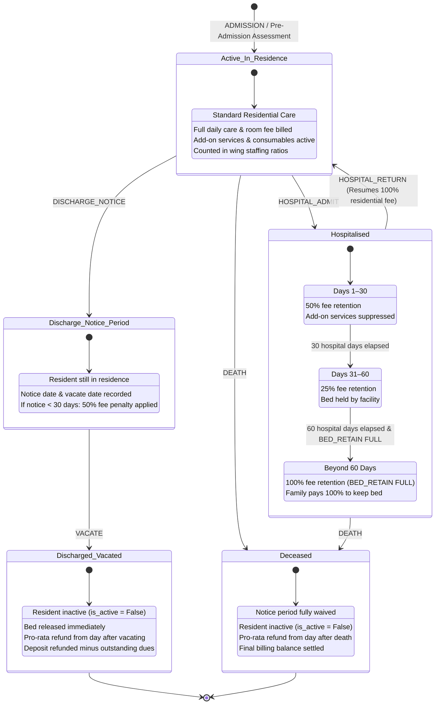
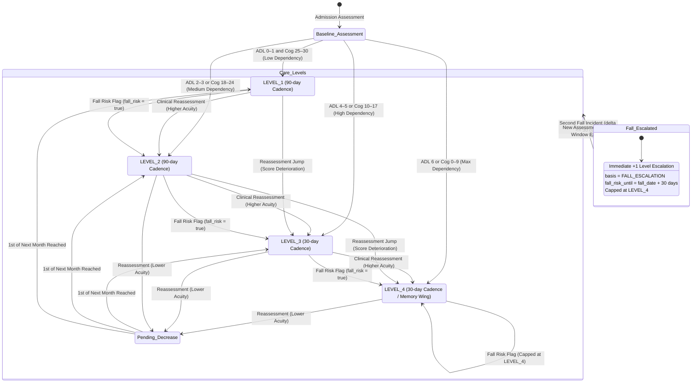

# Resident Lifecycle & Care-Level State Diagrams — PS-128 (Team T025)

## Elderly Care Home Resident Care-Level Billing and Staffing Ratio Engine

---

## 1. Executive Summary

In the **Elderly Care Home Management Engine (PS-128)**, resident records transition through a dual-layered state architecture:

1. **Operational Lifecycle States**: Manages physical residency, hospitalisation episodes, discharge notice windows, bed releases, and post-departure financial reconciliations. Implemented across `src/billing.py` and `src/main.py`.
2. **Clinical Acuity & Care-Level States**: Manages clinical dependency tiers (`LEVEL_1` to `LEVEL_4`), fall-risk elevations, acute fall escalations, and periodic reassessment cadences. Implemented in `src/care_levels.py` and audited in `src/compliance.py`.

All states, transitions, events, and guard conditions documented below are extracted directly from the working Python source code and verified against `data/README.md` and `decision_log.md`.

---

## 2. Operational Lifecycle State Diagram

The diagram below models a resident's physical and administrative presence in the facility, capturing admissions, hospitalisation tiers, discharge notice handling, departures, and death.

---

## 3. Clinical Care-Level & Acuity Progression State Diagram

This state machine models how a resident's clinical acuity moves between dependency tiers (`LEVEL_1` through `LEVEL_4`), including conflict resolution, immediate elevations, fall escalations, and deferred decreases.

---

## 4. Detailed State Descriptions

### Operational States

| State | Module Reference | Description & Business Rules | Billing & Staffing Impact |
|---|---|---|---|
| **`Active_In_Residence`** | `src/billing.py` `src/staffing.py` | Resident is actively residing in their assigned wing and room. | - Billed standard daily rate (`monthly_fee / days_in_month`). - Add-ons and consumables actively billed. - Included in wing headcounts for caregiver/nurse staffing ratios. |
| **`Hospitalised: Days 1–30`** | `src/billing.py` (`HospitalEpisode`) | Resident admitted to an external hospital; stay is $\le 30$ continuous days. | - Retention fee: **50% of base daily fee** (`HOSPITAL_RETENTION`). - Bed held for resident. - Add-on services (physio, diet) suppressed (EC-04). |
| **`Hospitalised: Days 31–60`** | `src/billing.py` (`HospitalEpisode`) | Continuous hospital stay exceeds 30 days but is $\le 60$ days. | - Retention fee: **25% of base daily fee** (`HOSPITAL_RETENTION`). - Bed held for resident. - Cumulative days tracked across billing-month boundaries. |
| **`Hospitalised: Beyond 60 Days`** | `src/billing.py` (`HospitalEpisode`) | Hospital stay exceeds 60 days. Family elects to retain bed via `BED_RETAIN FULL`. | - Retention fee: **100% of base daily fee** (`HOSPITAL_RETENTION`). - If `BED_RETAIN` not commanded, bed would be released. |
| **`Discharge_Notice_Period`** | `src/billing.py` | Resident or family has submitted a departure notice (`DISCHARGE_NOTICE`). | - Resident remains in facility until `vacate_date`. - If notice period $< 30$ days, **50% of one month's fee** is charged as short-notice fee (EC-08: RES-004). |
| **`Discharged_Vacated`** | `src/billing.py` (`vacate_events`) | Resident has permanently left the facility (`VACATE`). Terminal state. | - Resident deactivated (`is_active = False`). - Pro-rata refund from day after vacating. - Deposit refunded within 30 days minus unpaid dues. |
| **`Deceased`** | `src/billing.py` (`death_events`) | Resident has passed away (`DEATH`). Terminal state. | - Resident deactivated (`is_active = False`). - 30-day notice period **fully waived**. - Pro-rata refund of fee from the day after death (RES-023). |

---

### Clinical Care-Level States

| State | Cadence | ADL Band | Cognitive Band | Staffing Ratios (Day / Night) |
|---|---|---|---|---|
| **`LEVEL_1`** | 90 days | 0–1 | 25–30 | Caregiver 1:8 / 1:16 (Nurse 1:20 / 1:40) |
| **`LEVEL_2`** | 90 days | 2–3 | 18–24 | Caregiver 1:5 / 1:10 (Nurse 1:20 / 1:40) |
| **`LEVEL_3`** | 30 days | 4–5 | 10–17 | Caregiver 1:3 / 1:3 (Nurse 1:20 / 1:40) |
| **`LEVEL_4`** | 30 days | 6 | 0–9 | Caregiver 1:2 / 1:2 (Nurse 1:20 / 1:40, Memory Wing) |
| **`Pending_Decrease`** | — | — | — | Temporary holding state for clinical improvements. Resident is billed and staffed at the previous higher care level until the 1st of the following month. |
| **`Fall_Escalated`** | 30 days | — | — | Immediate 1-level elevation resulting from 2 falls within $\le 30$ days. Billed at elevated rate from the fall date; deposit adjusted if crossing tiers. |

---

## 5. Event Trigger & Transition Table

The following table details every supported system event, the source and destination states, and the exact business rules enforced:

| Event Trigger | Arguments | Source State | Target State | Guard Conditions & Business Rules |
|---|---|---|---|---|
| `ADMISSION` | `ASM-nnnn` | `[*]` | `Active_In_Residence` | ADL and cognitive scores mapped; highest level taken on conflict (EC-01). 2-month deposit recorded. |
| `PERIODIC` | `ASM-nnnn` | `Care_Levels` | `Care_Levels` or `Pending_Decrease` | If higher level: effective **immediately** (EC-03). If lower level: effective **1st of next month** (RES-050). |
| `FALL` (Incident) | `ts, location` | `Active_In_Residence` | `Active_In_Residence` or `Fall_Escalated` | Evaluates fall history. If previous fall occurred within $\le 30$ days, triggers `Fall_Escalated` (+1 level, EC-07). |
| `FALL` (Assessment) | `reason=FALL` | `Care_Levels` | `Care_Levels` | Sets `fall_risk = true`; elevates level by +1 capped at LEVEL_4 (EC-02). Sets `fall_risk_until = date + 30 days`. |
| `HOSPITAL_ADMIT` | `date, hospital` | `Active_In_Residence` | `Hospitalised (Days 1–30)` | Starts hospital episode. Pro-rates in-residence days and hospital retention days (50%). Excludes add-ons (EC-04). |
| *(Day Counter)* | Continuous | `Days 1–30` | `Days 31–60` | When cumulative hospital stay exceeds 30 calendar days, fee drops from 50% to 25%. Continuous across month ends. |
| `BED_RETAIN` | `date, FULL` | `Days 31–60` | `Beyond 60 Days` | After 60 hospital days, family pays 100% retention to hold bed. Continuous stay tracking (RES-029). |
| `HOSPITAL_RETURN`| `date` | `Hospitalised` | `Active_In_Residence` | Concludes hospital episode. Full residential rate resumes pro-rata from return date. |
| `DISCHARGE_NOTICE`| `notice, vacate`| `Active_In_Residence` | `Discharge_Notice_Period` | If `(vacate - notice) < 30 days`, applies 50% one-month fee penalty (`NOTICE_CHARGE`, EC-08). |
| `VACATE` | `date` | `Discharge_Notice_Period` | `Discharged_Vacated` | Marks resident inactive (`is_active = False`). Calculates pro-rata refund from day after vacating. Releases bed. |
| `DEATH` | `date` | Any active state | `Deceased` | 30-day notice period waived. Resident deactivated. Pro-rata refund from day after death (RES-023). |

---

## 6. Edge Cases Mapped to State Transitions

Every planted trap and edge case from `data/README.md` represents a specific transition or guard condition in this state model:

1. **EC-01 (Conflict Resolution)**:
   - *Resident:* `RES-025`
   - *State Rule:* Assessment scoring where ADL 3 implies `LEVEL_2` while cognitive score 17 implies `LEVEL_3`. The state transition resolves to `LEVEL_3` consistently (takes higher acuity).
2. **EC-02 (Fall-Risk Capping)**:
   - *Resident:* `RES-070`
   - *State Rule:* Resident already in `LEVEL_4` has `fall_risk = true`. Transition to $\text{LEVEL\_5}$ is disallowed; remains capped in `LEVEL_4`.
3. **EC-03 (Immediate Level Increase on Month-End)**:
   - *Resident:* `RES-015`
   - *State Rule:* Reassessment on 2026-08-31 raises `LEVEL_2` $\rightarrow$ `LEVEL_3`. State transition occurs on 31 August itself; August is billed 30 days @ LEVEL_2 and 1 day @ LEVEL_3, with deposit difference billed immediately.
4. **EC-04 (Hospital Stay Boundary)**:
   - *Resident:* `RES-039`
   - *State Rule:* Admitted 2026-08-06, returned 2026-09-05 (exactly 30 days). Remains entirely within the `Days 1–30 (50%)` substate; never enters the 25% substate. Add-on on 2026-08-12 is ignored.
5. **EC-07 (Second Fall on Exact 30th Day)**:
   - *Resident:* `RES-014`
   - *State Rule:* Falls on 2026-08-20 and 2026-09-19 ($\Delta = 30$ days). Because $\Delta \le 30$ days is inclusive, triggers transition to `Fall_Escalated` with `basis = FALL_ESCALATION`.
6. **EC-08 (Short Notice Charge)**:
   - *Resident:* `RES-004`
   - *State Rule:* Notice given 2026-09-02 to vacate 2026-10-01 (29 days). Guard condition evaluates $< 30$ days, triggering 50% monthly fee charge.
7. **RES-023 (Death Waiver)**:
   - *State Rule:* Death on 2026-09-23 transitions to `Deceased`. Notice period is waived; pro-rata refund applies from 2026-09-24.
8. **RES-029 (66-Day Cumulative Hospital Stay)**:
   - *State Rule:* Admitted 2026-08-03, returned 2026-10-08. Transitions continuously through `Days 1–30 (50%)` $\rightarrow$ `Days 31–60 (25%)` $\rightarrow$ `Beyond 60 Days (BED_RETAIN FULL 100%)`.
9. **RES-050 (Next-Month Care Level Decrease)**:
   - *State Rule:* Reassessment on 2026-09-12 lowers `LEVEL_3` $\rightarrow$ `LEVEL_2`. Transitions to `Pending_Decrease`; remains at `LEVEL_3` through September 30, and officially enters `LEVEL_2` on October 1.
10. **RES-033 (Late Reassessment Audit)**:
    - *State Rule:* Due date 2026-08-06; assessment conducted 2026-08-22 (16 days late). Fall on 2026-08-15 cannot raise billing rate until assessment state is renewed. Flagged as `OVERDUE_REASSESSMENT`.

---

## 7. Code Implementation References

The state machines documented above are implemented across the following source modules:

- **Care Level State Transitions**: Implemented in [`src/care_levels.py`](file:///C:/Users/Navya/.gemini/antigravity/scratch/T025-PS-128/src/care_levels.py) via `CareLevelManager.process_assessment()` and `record_fall()`.
- **Hospitalisation & Departure States**: Implemented in [`src/billing.py`](file:///C:/Users/Navya/.gemini/antigravity/scratch/T025-PS-128/src/billing.py) via `HospitalEpisode`, `process_command()`, and daily pro-rating loops in `_calculate_daily_fees()`.
- **Compliance Monitoring of States**: Implemented in [`src/compliance.py`](file:///C:/Users/Navya/.gemini/antigravity/scratch/T025-PS-128/src/compliance.py) via `check_overdue_reassessments()` and `check_late_payments()`.
- **Event Dispatching**: Handled in [`src/main.py`](file:///C:/Users/Navya/.gemini/antigravity/scratch/T025-PS-128/src/main.py) via sequential command stream iteration.
